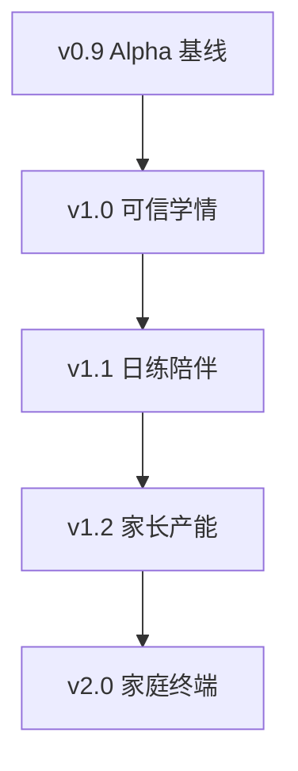

# 家庭学习 Jarvis · 分阶段版本计划

> **层级**：L1 场景域 · 路线图（可部署版本）  
> **记录日期**：2026-07-16  
> **依据**：[试用后-遗留问题与下一步推进](./试用后-遗留问题与下一步推进.md) · [功能架构 §16.5](./功能架构-模块与数据流.md) · [待办-P1](./待办-P1录入与家长对话.md)  
> **原则**：每一阶段发布后都是**可独立部署、可独立试用**的完整版本；下阶段在上阶段基线上叠加，不拆半成品依赖。

---

## 0. 规划方法

### 0.1 版本设计约束

| 约束 | 含义 |
|------|------|
| **完整版本** | 该阶段交付后，家庭可按手册部署并连续使用 ≥1 周，无需工程师值守 |
| **旅程闭环** | 每版至少打通一条「角色 × 场景」完整路径（学生或家长），不交付孤立模块 |
| **重要 × 成本** | 高重要低成本优先；高重要高成本拆成可部署切片；低重要高成本暂缓 |
| **试用驱动** | 每版设观察指标；未达标可延期下版范围，不跳级做形态演进 |

### 0.2 重要程度 × 实现成本矩阵

| 项 | 重要 | 成本 | 归入版本 | 理由 |
|----|------|------|----------|------|
| 试用观察 + 主攻单元 Wiki/题加深 | ★★★ | 低 | **v1.0** | 立刻影响「愿不愿意再用」 |
| 家长学情订正 + provenance | ★★★ | 中 | **v1.0** | 信任根基；文档 #1 |
| 周报 × 证据链串联 | ★★★ | 中 | **v1.0** | 家长每周 3 分钟闭环；文档 #2 |
| 局域网接入一页纸 / 二维码 | ★★☆ | 低 | **v1.0** | 试用摩擦，低成本 |
| 年级边界拦截加强 | ★★☆ | 低 | **v1.0** | 已有骨架，补硬规则即可 |
| 微计划「今日练」产品化 | ★★★ | 中 | **v1.1** | 孩子日活；工具已有 |
| 鼓励性进度视图（T4） | ★★★ | 中 | **v1.1** | 「感觉有进步」；无薄弱清单 |
| 真流式 SSE（非秒回） | ★★☆ | 中高 | **v1.1** | 等待体验；可降级提示 |
| 中档「待确认」轻量 UI | ★★☆ | 中 | **v1.2** | 降 inbox 过载；依赖归类稳定数据 |
| T1 家长 PDF 一键入库 | ★★★ | 中高 | **v1.2** | 解除内容扩展瓶颈；复用三分流 |
| T2 对话式录入 | ★★☆ | 高 | **v2.0** | 三决策留白未拍板；成本高 |
| 内容包云分发（只读公共包） | ★★☆ | 中高 | **v2.0** | 服务形态演进 |
| PWA / 平板壳 | ★★☆ | 中 | **v2.0** | 终端形态；不阻塞学情 |
| 多模态课本题推题 | ★☆☆ | 很高 | **暂缓** | 问题4 本期不做 |
| 公网多租户 / 原生双端 App | ★☆☆ | 很高 | **暂缓** | Alpha 不承诺；与试用目标不对齐 |
| 多孩切换 UI | ★☆☆ | 中 | **暂缓 / v2.x** | 单孩试用足够 |

### 0.3 版本总览

```text
v0.9 家庭 Alpha（当前）──── 已能通：聊 / 练 / 拍 / 说 / 家长看 inbox
         │
         ▼
v1.0 可信学情版 ─────────── 家长敢信、主攻单元够用、试用可观测
         │
         ▼
v1.1 日练陪伴版 ─────────── 孩子知道今天干嘛、练完有进步感、等得没那么烦
         │
         ▼
v1.2 家长产能版 ─────────── 家长自己扩内容（PDF）、inbox 不崩
         │
         ▼
v2.0 家庭终端版 ─────────── 本地私密 + 云内容包 + PWA；可选对话录入
```

| 版本 | 主题一句话 | 建议周期 | 主用户价值 |
|------|------------|----------|------------|
| **v0.9** | 家庭 Alpha 试用基线 | 已部署 | 端到端能用 |
| **v1.0** | 可信学情 | 2–3 周 | 家长信任 + 内容够深 |
| **v1.1** | 日练陪伴 | 2–3 周 | 孩子愿意天天来 |
| **v1.2** | 家长产能 | 3–4 周 | 家长自己扩 KP/题 |
| **v2.0** | 家庭终端 | 4–6 周 | 可复制部署形态 |

---

## 1. v0.9 · 家庭 Alpha（当前基线 · 已部署）

### 1.1 版本定位

**能通**：孩子 Web 聊天 / 讲练 / 按住说话 / 拍照入学情；家长学情总览与待归类。

### 1.2 已包含（不重复开发）

- S‑A→S‑D 拍照→学情链路  
- 问题5 情境工具契约、问题6 语数入库机制  
- P0/P1：服务端 ASR、脱敏、讲新课预检、年级边界初版、学伴行为档  
- 家长 `/kp-review`、`/exercises`、周报 Tab（证据链未产品化串联）

### 1.3 本版已知缺口（交由后续版本）

见 [试用后-遗留问题与下一步推进](./试用后-遗留问题与下一步推进.md) §1。

### 1.4 部署口径

按 [家庭Alpha-全新部署手册](../家庭Alpha-全新部署手册.md) / [启动手册](../家庭Alpha-启动手册.md) 部署；**不承诺**整册覆盖、流式秒回、多孩、公网。

---

## 2. v1.0 · 可信学情版

> **完整旅程**：家长周末打开 8770 → 看懂本周学情 → 点开证据 → 订正误判 → 孩子下周按订正后的薄弱继续练；同时主攻单元「讲得动、练得够」。

### 2.1 为什么先做这一版

| 维度 | 说明 |
|------|------|
| 重要 | 试用流失主因是「家长不信 / 内容太浅」，不是缺 App |
| 成本 | 订正 + 周报串联为中等成本；内容加深以运营为主、工程量小 |
| 系统性 | 闭合「学情权威」环；后续微计划、录入都依赖可信 gap |

### 2.2 范围内（Must）

| # | 交付项 | 对应遗留 | 成本 |
|---|--------|----------|------|
| A1 | **试用观察表**（周报式：对话轮次、inbox 积压、ASR 失败、家长抱怨 Top3） | P0 观察 | 低 |
| A2 | **主攻单元内容加深**：Wiki 教案 ≥3–5 篇可用深度 + 该单元可练题达标（建议 ≥15 道可用 exact/numeric） | 问题6 / Wiki 骨架 | 低–中（运营） |
| A3 | **家长 gap 学情订正**（改掌握档 / 忽略误标）+ **操作留痕 provenance** | §16.5 #1、manual_override | 中 |
| A4 | **周报 × 证据链**：周报条目可点到 attempt 或 photo 来源 | §16.5 #2 | 中 |
| A5 | **局域网接入一页纸**（主机名或二维码进 8771） | 体验 | 低 |
| A6 | **年级边界硬拦截** 强化回归（超纲温和拒绝可复测） | I3 | 低 |

### 2.3 范围外（本版不做）

- 微计划 UI、鼓励视图、真流式 SSE  
- PDF Web 入库、对话录入、内容云、PWA  
- 多模态题型、多孩、公网  

### 2.4 部署后用户承诺（本版「完整」定义）

| 角色 | 承诺 |
|------|------|
| 家长 | 每周 ≤5 分钟：看周报 → 点证据 → 订正至少一类误判 |
| 孩子 | 主攻单元可连续「讲 10 分钟 + 练一小波」不空洞 |
| 运维 | 按观察表每周记一页；无工程师也可按手册启停 |

### 2.5 验收标准（可发布门槛）

- [ ] 8770：对某 gap 执行订正后，孩子端后续推题/讲解与订正一致；留痕可查  
- [ ] 8770 周报：至少 1 条条目可下钻到 attempt 或照片证据  
- [ ] 主攻单元：`explain_kp` 非占位空讲；`questions_suggest` 能推出 ≥3 道有效题  
- [ ] 观察表模板入库文档；试用家庭跑满 1 周有记录  
- [ ] 手动验证手册增补「模块 J · 学情订正与周报证据」并通过  

### 2.6 建议工期与切片

| 切片 | 内容 | 约工时 |
|------|------|--------|
| J1 | gap 订正 API + 8770 UI + provenance | 3–5 天 |
| J2 | 周报证据下钻 | 2–3 天 |
| J3 | 主攻单元 Wiki/题运营包 + 年级边界回归 | 并行 3–5 天 |
| J4 | 观察表 + 局域网一页纸 + 手册更新 | 1–2 天 |

**合计约 2–3 周**（1 人全职或等价）。

---

## 3. v1.1 · 日练陪伴版

> **完整旅程**：孩子打开 8771 → 看见「今天练什么」→ 按住说话或打字完成 → 结束看到「今天攻下了 / 练了什么」→ 等待感可接受。

### 3.1 为什么第二做

| 维度 | 说明 |
|------|------|
| 重要 | 解决「不知道今天干嘛 / 像会说话的卷子」 |
| 成本 | StudyPlan / streak 代码已有，产品化中等成本；SSE 中高但可降级 |
| 系统性 | 建立在可信 gap（v1.0）之上，进步反馈才真实 |
| 依赖 | **必须 v1.0 已部署**；否则鼓励视图展示的是不可信数据 |

### 3.2 范围内（Must）

| # | 交付项 | 对应遗留 | 成本 |
|---|--------|----------|------|
| B1 | **今日微计划入口**（Welcome / 固定话术触发「开始今天的练习」） | §16.5 #3 | 中 |
| B2 | **streak → mastered 产品可验证路径**（练对累计 → 掌握提示） | §16.5 #3 | 中 |
| B3 | **鼓励性进度视图（T4）**：只看最近进步 / 练了什么，**不展示薄弱清单** | §16.5 #4 | 中 |
| B4 | **真流式 SSE**（首 token 可见；非承诺「秒回」）或等价分段展示 | §16.5 #5 | 中高 |
| B5 | ASR 失败 / 长等待 **文案与降级提示** 打磨 | 体验 | 低 |

### 3.3 范围外

- PDF 入库、对话录入、待确认队列（放 v1.2）  
- 孩子端完整「学情仪表盘」（仍不承诺薄弱清单）  

### 3.4 部署后用户承诺

| 角色 | 承诺 |
|------|------|
| 孩子 | 每天有明确「今日练」；练完有一句进步反馈 |
| 家长 | 无需盯场；周末仍用 v1.0 周报看结果 |
| 体验 | 多数回复可见流式输出；失败有可理解提示 |

### 3.5 验收标准

- [ ] Welcome 或一键可进入今日微计划，完成一轮练（≥3 题）有结束反馈  
- [ ] 连续做对达 streak 阈值后，出现掌握/攻克类提示（可测）  
- [ ] 孩子端进度区无薄弱 KP 列表（符合 T4）  
- [ ] 流式：Network 可见 SSE 或等效；首包延迟可感知优于纯转圈  
- [ ] 试用家庭连续 5 个学习日至少 3 天有「今日练」记录  

### 3.6 建议工期

约 **2–3 周**（微计划+鼓励 为主；SSE 可并行）。

---

## 4. v1.2 · 家长产能版

> **完整旅程**：家长上传教材 PDF → 自动三分流（KP / 题库 / inbox）→ 待确认轻点确认 → inbox 仅剩真正难例；无需工程师 CLI。

### 4.1 为什么第三做

| 维度 | 说明 |
|------|------|
| 重要 | 扩展试用家庭 / 新单元时，CLI 录入会卡死扩展 |
| 成本 | T1 中高（需 Web 上传 + 接现有解析器）；待确认 UI 中等 |
| 系统性 | 学情可信（v1.0）+ 日练（v1.1）后，**内容供给**成为瓶颈  
| 顺序 | **T1 先于 T2**；T2 决策留白未清，不进本版 |

### 4.2 范围内（Must）

| # | 交付项 | 对应遗留 | 成本 |
|---|--------|----------|------|
| C1 | **T1 家长页 PDF 一键入库**（选解析器 / 教材 → 与 CLI 同分流） | 待办 T1 | 中高 |
| C2 | 入库报告页（KP 数 / 题数 / inbox 数）与 kp-review **无纯习题脏 job** | 待办验收 | 中 |
| C3 | **中档待确认轻量 UI**（非重操作 inbox） | §16.5 #5 待确认 | 中 |
| C4 | 主流程教材至少 1 条（如沪教英或语数）Web 路径与 CLI 结果一致 | T1 验收 | — |

### 4.3 范围外

- T2 对话式录入（→ v2.0，需先拍板 §1.4 三决策）  
- T3 任意新教材解析器（按需单开，不堵本版发布）  
- 多模态题入库为可推题型（仍走课堂活动清单策略）  

### 4.4 部署后用户承诺

| 角色 | 承诺 |
|------|------|
| 家长 | 不装 CLI：浏览器上传 PDF 即可扩展已支持教材 |
| 系统 | 分流正确；kp-review 不被练习题污染 |
| 运维 | 新家庭扩单元主要靠家长 + 已支持解析器 |

### 4.5 验收标准

- [ ] 8770 上传样例 PDF，catalog / 题库 / inbox 与同脚本 CLI 报告一致  
- [ ] kp-review 默认列表无「仅练习题」批次  
- [ ] 待确认队列可一键确认 / 驳回，结果写入学情或回 inbox  
- [ ] 手动验证手册增补「模块 K · PDF Web 入库」并通过  

### 4.6 建议工期

约 **3–4 周**。

### 4.7 本版前必须拍板（最小集）

| 决策 | 建议默认（可改） |
|------|------------------|
| Web PDF 入库后 KP 是否经 kp-review | **与现 CLI 沪教策略一致**：KP 可直写或可配置；练习题走 inbox/题库 |
| 是否开放「家长自选任意 PDF」 | **否**：仅白名单解析器 + 教材标签，避免垃圾入库 |

（T2 相关三决策仍可留到 v2.0。）

---

## 5. v2.0 · 家庭终端版

> **完整旅程**：新家庭按「一键/一包」部署 → 下载年级内容包 → 孩子用 PWA、家长用同域家长模式 → 学情仅存本地；可选对话协助录入。

### 5.1 为什么放后面

| 维度 | 说明 |
|------|------|
| 重要 | 复制部署、降低装机成本；但不解决「敢不敢用」 |
| 成本 | 内容包协议 + PWA +（可选）T2 均为中高～高 |
| 系统性 | 产品旅程（v1.0–v1.2）跑通后再做**服务形态**，避免空壳终端 |

### 5.2 范围内（Must）

| # | 交付项 | 对应遗留 / 建议 | 成本 |
|---|--------|-----------------|------|
| D1 | **内容包格式**（KP + seed 题 + Wiki 骨架，版本化，不含学情） | 服务形态 | 中高 |
| D2 | 家庭机 **下载 / 校验 / 导入** 内容包（只读公共层） | 同上 | 中 |
| D3 | **PWA 或平板壳**（8771 为主，可加家长书签） | 终端 | 中 |
| D4 | 部署手册升级为「内容包 + 运行时」两层说明 | 文档 | 低 |

### 5.3 范围内（Should / 可裁剪）

| # | 交付项 | 条件 |
|---|--------|------|
| D5 | **T2 对话式录入** | 先关闭待办 §5 三决策留白 |
| D6 | 可选加密备份（学情不出明文上云） | 有明确家庭需求再做 |
| D7 | 手机端家长「待办提醒」轻入口 | 不替代 8770 |

### 5.4 范围外（本阶段仍暂缓）

- 公网多租户 SaaS、原生 iOS/Android 双端完整 App  
- 多模态课本题自动推题与口语评分  
- 班级 LMS / 教师排课  

### 5.5 部署后用户承诺

| 角色 | 承诺 |
|------|------|
| 新家庭 | 不依赖开发者手工 `pip` 灌内容：下包 + 启服务即可开练 |
| 隐私 | 学情 / 对话 / 照片默认不出家庭主机 |
| 终端 | 平板主屏可「像 App」打开孩子端 |

### 5.6 验收标准

- [ ] 空白机：导入内容包后 bootstrap / catalog 达标，无需拷贝开发机 `student_data`  
- [ ] PWA 可安装；离线至少能打开壳（在线对话仍可依赖云 API）  
- [ ] 文档写清：私密数据路径 vs 公共包路径  
- [ ] 若含 T2：待办 T2 验收表全部勾选  

### 5.7 建议工期

约 **4–6 周**（含不含 T2 可 ±2 周）。

---

## 6. 跨版本并行轨（不阻塞发版）

以下工作**每个版本都可穿插**，但不单独占用「版本主题」：

| 并行轨 | 内容 | 说明 |
|--------|------|------|
| **内容运营** | 数学后几单元补题、语文 exact、Wiki 加深 | 用现有 `/kp-review`；算运营包，不算产品缺口 |
| **试用观察** | 每周观察表 | 发现 P0 bug 可热修进当前版本补丁（v1.0.1…） |
| **解析器按需** | T3 新教材 | 有明确教材再开；不进版本必达 |
| **识别上限** | 手写密集准确率 | 保持「已知限制」；不设版本门禁 |

补丁版本号建议：`v1.0.x` 仅修稳定性 / 脱敏 / ASR，不塞新旅程。

---

## 7. 暂缓清单（明确不进 v1.x / v2.0 Must）

| 项 | 再评估条件 |
|----|------------|
| 多模态课本题推题（听/图/配对） | 试用证明纯文本不够用，且有媒体资源管线预算 |
| 公网多租户 | 有运维与合规方案；且本地部署已复制 ≥N 户 |
| 原生双端 App | PWA 验证日活不足且厂商推送成为刚需 |
| 多孩切换 UI | 单户明确第二孩需求 |
| 流式「秒回」SLA | 模型侧延迟下降后再承诺 |

---

## 8. 版本依赖与回滚



| 规则 | 说明 |
|------|------|
| 禁止跳级 | 不做「无订正先做 PWA」 |
| 可裁剪 | v1.1 的 SSE 可降级为更好的等待文案仍标发布；鼓励视图不可裁 |
| 回滚 | 每版保留上一版启动手册与 tag；数据迁移脚本须可逆或可冷备 |

---

## 9. 每版发布检查清单（通用）

发任何 `v1.x` / `v2.0` 前：

1. [ ] 本版「用户承诺」表可对外说清  
2. [ ] `/health` bootstrap + asr（若声明语音）正常  
3. [ ] 手动验证手册对应新模块打勾  
4. [ ] 全新部署手册 / 启动手册增补本版差异  
5. [ ] git tag：`family-alpha-v1.0` 等形式  
6. [ ] 试用观察：上版指标无 P0 未关闭项  

---

## 10. 与既有文档的映射

| 本计划 | 映射来源 |
|--------|----------|
| v1.0 | 试用后 §2.5 P0–P1；功能架构 §16.5 #1 #2 |
| v1.1 | §16.5 #3 #4 #5（流式）；Wave C |
| v1.2 | 待办 T1 + 待确认 UI；Wave D 前半 |
| v2.0 | 试用后 §2.4 服务形态 + T2 |
| 暂缓 | 问题4 §8.3；Alpha 不承诺项 |

---

## 11. 一句话路线

**先让家长信学情（v1.0），再让孩子天天来（v1.1），再让家长自己喂内容（v1.2），最后才做成可复制的家庭终端（v2.0）。**  
多模态推题与公网 SaaS 不进这条主路，除非试用数据证明瓶颈已变。

---

## 修订记录

| 日期 | 说明 |
|------|------|
| 2026-07-16 | 初版：v0.9→v2.0 分阶段可部署计划；重要×成本矩阵 |
