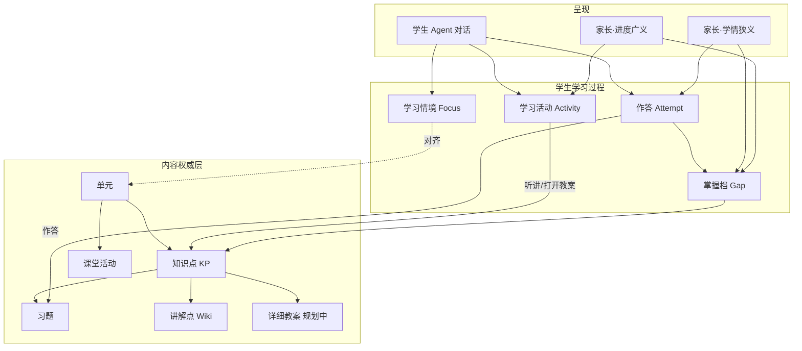

# 领域概念与业务过程复盘（建议稿）

> **层级**：L1 场景域 · 产品复盘（建议，待评审拍板）  
> **记录日期**：2026-07-19  
> **触发**：试用中「做了题但家长学情为空」（见 [待办 T5](./待办-P1录入与家长对话.md)）；共识是**不能再单点打补丁**，须先理清概念与正确业务过程，再梳理教育 Agent 功能。  
> **效力**：本文件**不重定义** [L0 能力契约](../L0-能力契约/Jarvis能力契约.md)；在 L0 之上厘清小学学习场景的「名词表 + 过程 + Agent 挂载边界」。  
> **关联**：[功能架构](./功能架构-模块与数据流.md) · [分阶段版本计划](./分阶段版本计划.md) · [试用后-遗留问题与下一步推进](./试用后-遗留问题与下一步推进.md)  
> **对外研讨稿（非 Markdown）**：[教育Agent产品分析-研讨稿.html](./教育Agent产品分析-研讨稿.html) — 第一性原理：教育过程建模 → 抽象 Agent 功能（不含试用/实现现状）

---

## 0. 为什么要做这次复盘

| 现状问题 | 表现 |
|----------|------|
| **概念混用** | 「学情」有时指 attempt/gap，有时指「今天学了什么」；家长预期 ≠ 系统实现 |
| **过程断裂** | 对话里「像在上课/考试」，底层未写权威对象（attempt / 活动账本） |
| **内容分层不清** | KP、习题、Wiki 讲解点、课堂活动、未来详细教案 职责重叠或空洞 |
| **单点修复风险** | 只修「强制 attempt_submit」而不定义「听讲算不算学情」，下周又会吵同一架 |

**目标**：先得到一份**可评审的概念表 + 端到端业务过程 + Agent 职责边界**；通过后再排工程（含 T5、v1.0 订正、教案深化等）。

---

## 1. 建议的核心概念表（先对齐名词）

> 下列为**建议定义**，评审时可改名，但同一产品里只能有一套含义。

### 1.1 角色与身份

| 概念 | 定义 | 当前载体 | 备注 |
|------|------|----------|------|
| **学生（Student）** | 学习主体；学情与进度归属人 | `student_id`（如 `g2-stu-01`） | 试用单孩 |
| **学生画像（Profile）** | 年级、称呼、爱好等「这个人」 | onboarding + M2 | 与学情证据分离（AP6） |
| **家长 / 教研** | 权威录入 KP、订正学情、看报告 | 8770 | 教研可与家长同入口试用 |

### 1.2 课程内容层（权威、偏静态）

| 概念 | 定义 | 权威源 | 当前载体 |
|------|------|--------|----------|
| **知识点 KP** | 可掌握的最小课程原子；学情坐标系 | 家长/教研确认的 KP 文档 | `kp_catalog.json` |
| **单元 Unit** | KP 的教学分组（册/单元） | 同上 | catalog `unit_id` |
| **习题 Question** | 可练习、可判分（或可 freeform）的题目 | 题库 / 审核入库 | SQLite `questions.db` |
| **讲解点 / Wiki 教案（浅）** | 支撑「讲新课」的要点文本 | KP 批准时同步或补写 | `wiki_data/raw/kp/*.md` |
| **详细教案 Lesson Plan（深，规划中）** | 目标、例题、活动步骤、板书/多媒体、课堂节奏 | 教研编写 | **尚未产品化**；勿与 Wiki 骨架混称「已有教案」 |
| **课堂活动 Classroom Activity** | 课本中不宜自动推题的听/说/演活动 | 解析器标记 | `classroom_activities.json`；**不进推题闭环** |

**原则建议**：

- KP 定义「学什么」；习题验证「会不会」；讲解点/教案定义「怎么教」。  
- 三者**分开演进**：缺题 ≠ 缺 KP；缺详细教案 ≠ 不能讲（可降级为讲解点）。

### 1.3 学习过程层（动态、属学生）

| 概念 | 定义 | 写入条件（建议） | 当前状态 |
|------|------|------------------|----------|
| **学习情境 Focus** | 当前学科/单元（对话对齐用） | 讲新课预检 / `learning_focus_set` | ✅ 有；**不等于学情** |
| **作答记录 Attempt** | 一次可追溯的答题证据 | `attempt_submit` / freeform / 拍照归类 | ✅ 有；家长页主数据 |
| **掌握档 Gap（KP 轴）** | 某 KP 上薄弱/掌握等结论 | 由 attempt 派生；可家长订正 | ✅ 有；订正 UI 弱 |
| **学习活动 Activity（建议新增）** | 「今天发生了什么学习事件」：听讲、练题、拍照… | Agent/系统显式记账 | ❌ **缺失** → 家长看不到听讲 |
| **学习进度 Progress（建议明确）** | 对单元/KP 的完成度视图：听讲覆盖 + 练习覆盖 + 掌握 | 聚合 Activity + Attempt + Gap | ❌ 未产品化；易与 Gap 混淆 |
| **会话记忆 Session/M2** | 对话连续性与人物偏好 | 对话自动 | ✅ 有；**不进家长学情表** |

### 1.4 「学情」一词建议拆开（避免再吵）

| 用语 | 建议含义 | 谁看 | 证据要求 |
|------|----------|------|----------|
| **学情（狭义）** | KP 掌握/薄弱 + 可追溯 attempt | 家长治理、推题 | 必须有证据或人工订正留痕 |
| **学习进度（广义）** | 今日/本周：听了什么、练了什么、还剩什么 | 家长周报摘要、孩子鼓励视图 | 活动账本即可；**不自动等于「已掌握」** |
| **人物理解** | 称呼、情绪、习惯 | 孩子对话体验 | M2；不进 KP 掌握表 |

**拍板建议**：家长首页同时展示两块——「本周进度（活动）」+「掌握与薄弱（学情狭义）」；禁止再用一个「学情」词覆盖两者。

---

## 2. 对象关系（建议一张图）



---

## 3. 正确业务过程（建议目标态）

### 3.1 内容侧（教研 / 家长）

```text
教材/PDF/对话录入
  → 三分流：KP(+讲解点) | 可判分习题 | 课堂活动/待审
  → 人审（KP 变更策略可配置）
  → catalog / 题库 / activities 生效
  →（可选）补详细教案到 KP
```

**不变**：习题不得冒充 KP 批次进 `/kp-review`（已有 T1–T4 约束）。

### 3.2 学生侧 · 讲新课

```text
意图「学某单元」
  → 对齐 Focus（预检/focus_set）
  → 取讲解点/教案（explain_kp；有详细教案则优先生效）
  → 分步讲解（对话）
  → 【建议】写入 Activity：type=teach, unit/kp, duration/summary
  → 不自动写 Gap「已掌握」
```

### 3.3 学生侧 · 练题（必须闭合）

```text
意图「出题/考考我」
  → questions_suggest（当前 Focus 单元）
  → 有题：question_get → 孩子作答 → attempt_submit → 更新 Gap
  → 无题：明确「本题库暂无」→ 换单元 / freeform / 拍照 / 请家长补题
  → 【禁止】纯口头出题+口头判分且不落库（T5）
  → 【建议】同时写 Activity：type=practice
```

### 3.4 学生侧 · 拍照作业

```text
上传理解 → 用户意图
  → 记学情：classify_photo → attempt/gap 或 inbox
  → 只讲解：explain，可写 Activity，不强制 Gap
```

### 3.5 家长侧

```text
看「进度」：今日/本周 Activity + 练习次数
看「学情」：Gap + 点开 Attempt/照片证据
订正：改 Gap，provenance 留痕（v1.0）
扩内容：KP/题入库（T1/T2）
```

### 3.6 教育 Agent 在过程中的位置

| Agent 该做 | Agent 不该做 |
|------------|--------------|
| 识别意图，按过程调用工具 | 用长文本假装完成了工具副作用 |
| 在工具结果上组织适龄讲解 | 自编题库题并声称「已计入学情」 |
| 空题库时诚实降级 | 把 Focus 切换说成「学会了」 |
| 共情与记忆（M2） | 用 M2 替代 Gap/Attempt |

**一句话**：Agent 是**过程编排器**，不是学情数据库本身；凡家长可见的结论，必须落在领域对象上。

---

## 4. 与现状差距（复盘用）

| 过程环节 | 现状 | 缺口类型 |
|----------|------|----------|
| 讲新课 → Focus | ✅ 预检会切单元 | 无 Activity |
| 讲新课 → 讲解质量 | 🟡 Wiki 多骨架 | 内容；详细教案未建模 |
| 练题 → 题库工具链 | ❌ 易被口头绕过（T5） | **编排合规** |
| 练题 → 家长可见 | 仅 Attempt | 依赖上链成功 |
| 听讲 → 家长可见 | ❌ | **概念+产品**（广义进度） |
| 家长订正 Gap | ❌/弱 | v1.0 |
| 详细教案 | ❌ | 内容模型扩展 |
| 语文等单元题量 | 弱/0 | 内容运营 |

---

## 5. 建议的工作方式（避免再单点）

### 5.1 先文档评审，再开功能

建议开一次 **L1 评审会**（可异步批注），只拍板下面问题，不写代码：

1. 「学情」是否拆成 **狭义掌握** + **广义进度**？（建议：是）  
2. Activity 最小字段集？（建议：`student_id, ts, type, unit_id?, kp_id?, ref_ids?, summary`）  
3. 口头自编题：禁止 / 仅 freeform 落库 / 允许但不进掌握？  
4. 详细教案与 Wiki 讲解点是同一文件升级，还是独立对象？  
5. 家长首页信息架构：进度块 + 掌握块如何排？

### 5.2 再映射到 Agent 功能清单

拍板后，用一张表收束 Agent 能力（示例）：

| 用户意图 | 必调工具/写入 | 禁止行为 | 家长可见 |
|----------|---------------|----------|----------|
| 学某单元 | focus + explain_kp + Activity(teach) | 编造超纲单元 | 进度：听讲 |
| 考考我 | suggest→get→attempt 或明确无题 | 口头闭环 | 学情：attempt |
| 我不会 | gap_query + explain | 无证据说「你老错」 | — |
| 拍照记错 | classify_photo | 上传即静默入库 | inbox/gap |
| 今天学了啥 | 读 Activity+Attempt | 用聊天总结冒充 | 周报 |

### 5.3 再映射到版本计划

| 复盘结论 | 落入版本 |
|----------|----------|
| T5 做题必落库 | **热修 / v1.0.x**（不阻塞概念，但属信任 P0） |
| Activity + 家长进度块 | **v1.0** 与周报证据一并设计 |
| 详细教案模型 | 内容轨；可与 v1.1 鼓励视图并行 |
| T1 PDF 入库 | v1.2（过程 3.1 的产能） |

**原则**：P0 合规（T5）可先做；**广义学情 UI** 必须等本节概念拍板，避免做完再推翻。

### 5.4 建议产出物清单

| # | 产出 | 负责人向 |
|---|------|----------|
| R1 | 本文件评审修订 → 「已拍板」状态 | 产品 |
| R2 | 《教育 Agent 意图→工具契约》一页表（可并入 prompts 附录） | 产品+工程 |
| R3 | Activity 数据模型与家长进度 API 草案 | 工程 |
| R4 | 详细教案最小 schema（相对 Wiki） | 教研+产品 |
| R5 | 更新功能架构 §16 / 分阶段计划交叉引用 | 文档 |

---

## 6. 给当前决策的简明建议

1. **同意全面复盘**：先概念与过程，再 Agent 功能表，再排期；T5 作为唯一例外允许并行热修（否则试用信任继续掉）。  
2. **立刻统一对外话术**：家长页当前展示的是「练习与掌握证据」，不是「今日听课流水」——手册与 UI 文案先改，减少预期差。  
3. **内容分层投资**：讲解点补深度 ≠ 上详细教案系统；题库补零题单元与 T5 同等紧急（否则合规修复后语文仍练不了）。  
4. **Agent 定位写死**：编排器 + 话术层；领域状态只通过工具写。  
5. **复盘文档收口**：以本文件 + 功能架构为场景真相源；单点问题一律回链到概念/过程条目，禁止只开 issue 不改模型。

---

## 7. 一句话

**学生是主体，KP/题/教案是内容，Attempt/Gap 是掌握证据，Activity/Progress 是过程足迹；Agent 只负责按正确过程调用工具。**  
把这四层说清，教育 Agent 的功能清单才会稳定，而不是每遇到一次试用抱怨就改一处提示词。

---

## 修订记录

| 日期 | 说明 |
|------|------|
| 2026-07-19 | 初稿：概念表、过程、Agent 边界、评审工作方式；响应 T5 与全面复盘诉求 |
